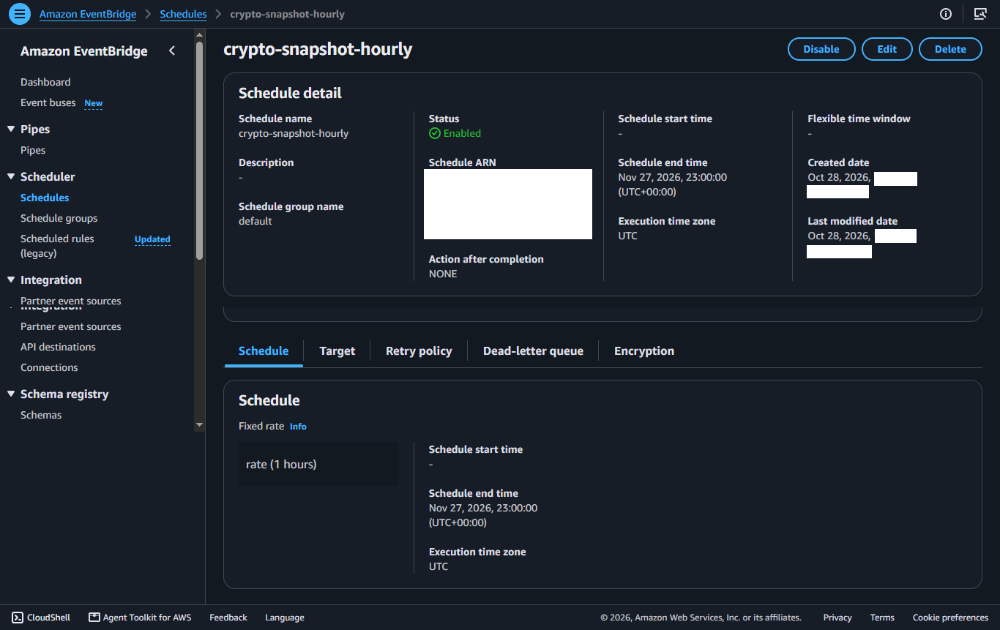
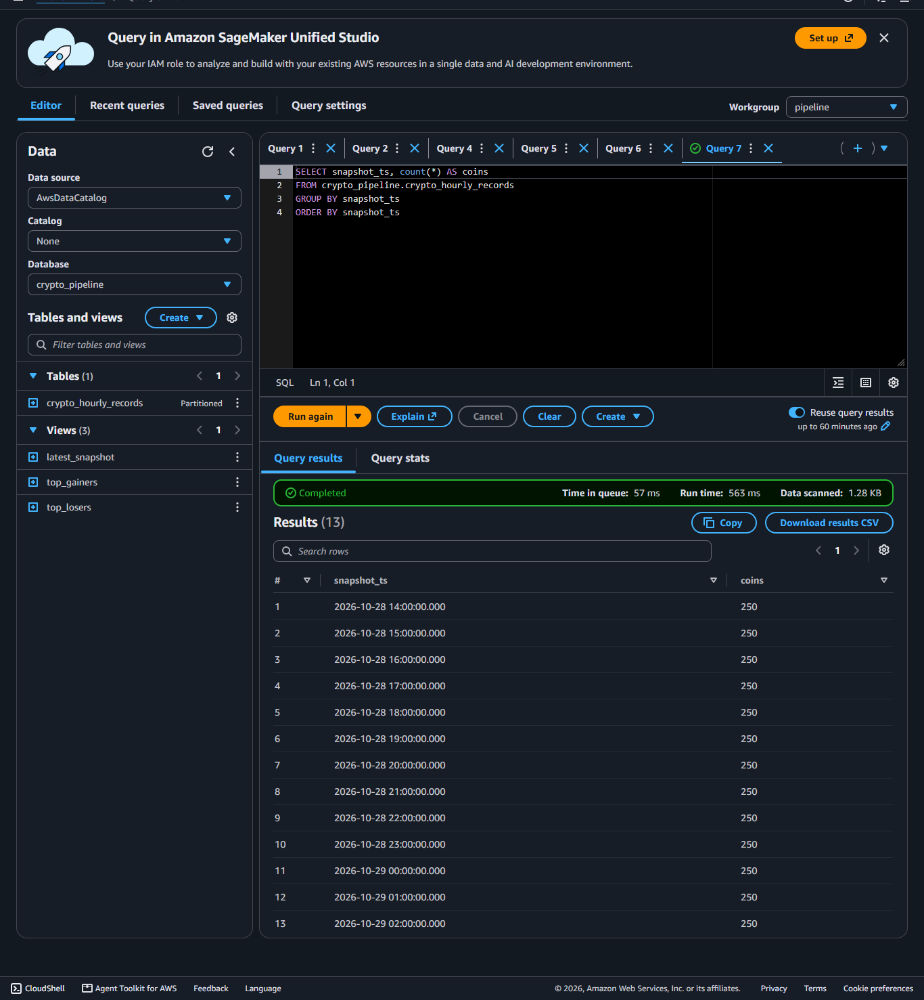

# Crypto Data Pipeline on AWS

An hourly serverless ETL pipeline that snapshots the top 250 cryptocurrencies by market cap from CoinGecko, stores them as Parquet on S3, and makes them queryable through Athena. The pipeline runs for about a month, and the main deliverable is a documented cost log of what it takes to run.

> **Status: in progress.** The pipeline has been running hourly since 28 Oct 2026. The cost log and the LLM query layer (Part 2) are still to come.

## Architecture

```
CoinGecko API
     │  hourly (EventBridge Scheduler)
     ▼
  Lambda ──► S3 raw/      (untouched API response, JSON)
     │
     └─────► S3 curated/  (cleaned Parquet, partitioned by date)
                   │
                   ▼
            Athena table (partition projection) + views
```

| Component | Purpose |
|---|---|
| EventBridge Scheduler | Triggers the Lambda every hour and passes the scheduled time |
| Lambda (Python) | Fetches one `/coins/markets` page, writes raw JSON and curated Parquet |
| SSM Parameter Store | Holds the CoinGecko API key (SecureString) |
| S3 | `raw/` for the API response, `curated/` for Parquet |
| Athena + Glue | SQL over `curated/` with partition projection, no crawler |

## Design decisions

- **Idempotent writes.** `snapshot_ts` is the scheduled time truncated to the hour, and every S3 key is built from it. A retry or re-run overwrites the same file instead of creating a duplicate.
- **Raw kept next to curated.** The curated Parquet can be rebuilt from `raw/` at any time (the Lambda has a `rebuild_from_raw` maintenance mode, which needs a temporary read policy).
- **Stable Parquet schema.** All numeric columns are cast to `float64` before writing. pandas would otherwise write `int64` or `double` depending on the hour's data, and Athena fails when the same column has different types across files.
- **Partition projection.** The `dt` partition is computed from a date range, so new days appear automatically with no crawler or manual partition registration.
- **Least-privilege IAM.** The Lambda role can only `PutObject` to `raw/*` and `curated/*` and read one SSM parameter.

## Repo layout

```
lambda/    Lambda function code
sql/       Athena table and view definitions
iam/       IAM policy documents (placeholders for account and bucket)
docs/      Cost log, lessons learned, screenshots
```

## Data

Each hourly snapshot has 250 rows (one per coin) with price, market cap, volume, 24h range, supply and all-time high/low fields, plus `snapshot_ts`. Athena views provide the latest snapshot and the top 10 gainers and losers.

## Evidence





More in [`docs/screenshots/`](docs/screenshots/) and [`docs/cost-log.md`](docs/cost-log.md).

## Cost log

Weekly cost tracking will be kept in [`docs/cost-log.md`](docs/cost-log.md). Early readings:

| Query | Files | Data scanned |
|---|---|---|
| `SELECT * FROM latest_snapshot` (day 1) | 13 | 56 KB |

## What I'd change at larger scale

*To be completed at the end of the run.* Notes so far: hourly writes create many small files, which would call for compaction at scale.

## Reproducing this

> The files in `iam/` and `sql/create_table.sql` are templates. Replace
> `<DATA_BUCKET>`, `<ACCOUNT_ID>` and `<REGION>` with your own values before
> using them. IAM and Athena will reject them with the angle brackets left in.

1. Create an S3 bucket with Block Public Access on, and a second bucket for Athena results.
2. Store a CoinGecko Demo API key in SSM Parameter Store as a SecureString.
3. Create the Lambda (Python, 512 MB, 60 s timeout) with the AWS SDK for pandas layer, using the policy in `iam/`.
4. Set the environment variables `BUCKET` and `SSM_PARAM_NAME`.
5. Create an EventBridge Scheduler schedule, `rate(1 hours)`, with the payload `{"scheduled_time": "<aws.scheduler.scheduled-time>"}`.
6. Run the SQL in `sql/` to create the table and views.

## Attribution

Market data provided by [CoinGecko](https://www.coingecko.com). 

## License

MIT, see [LICENSE](LICENSE). The license covers the code only, not the CoinGecko data.
